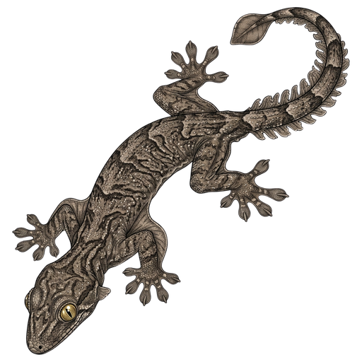
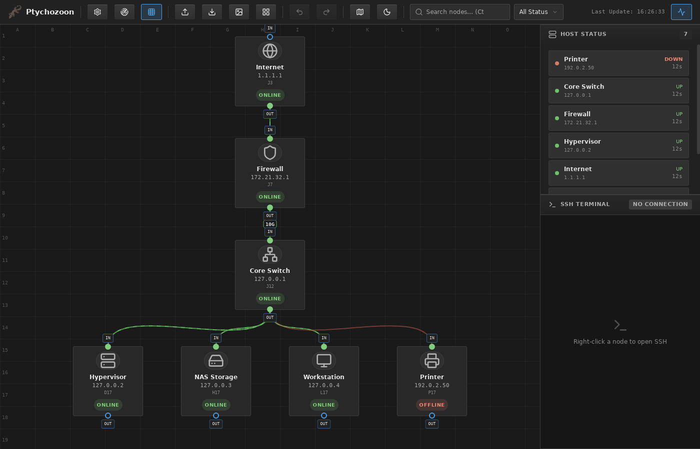

<p align="center"></p>

<h1 align="center">Ptychozoon</h1>

<p align="center">Topologie et supervision réseau, en application de bureau.</p>

<p align="center"></p>

Dessinez votre réseau, voyez en direct quels équipements répondent, et ouvrez un terminal SSH sur un nœud d’un clic droit. Le nom vient du gecko volant, qui plane d’arbre en arbre comme on passe d’un nœud à l’autre.

## Fonctions

- **Canevas** : nœuds, ports, liens principal / secours, conteneurs (Proxmox, Docker, rack…) et zones VLAN ; grille magnétique, mini-carte, annuler / rétablir.
- **Supervision** : ping, ports TCP, HTTP(S) et DNS, avec confirmation sur deux mesures, latence, historique et notifications système.
- **Découverte** : balayage d’une plage IPv4, table ARP et voisins IPv6, nom DNS et fabricant de chaque hôte.
- **SNMP v2c** : état des interfaces et charge des liens.
- **Flux de backup** : flèches de la machine sauvegardée vers sa copie, vertes, orange (en retard) ou rouges (en échec) selon la date du dernier backup, lue par SSH (dossier ou commande) ou HTTP.
- **SSH** : terminal intégré, mot de passe ou clé, vérification des clés d’hôte.
- **Actions rapides** : copier l’adresse, ouvrir l’interface web, traceroute, Wake-on-LAN.
- **Recherche** (`Ctrl+F`), export PNG / SVG, import / export JSON, thèmes sombre et clair.
- **Secrets** dans le trousseau du système (Gestionnaire d’identification sous Windows), jamais dans les fichiers ni les exports.

## Installation

Les installateurs Windows (`.exe`, `.msi`), Linux (`.deb`, `.rpm`, `.AppImage`) et macOS (`.dmg`) sont publiés sur la page [Releases](https://github.com/cehaho/Ptychozoon/releases).

Ils ne sont pas signés : au premier lancement, Windows affiche « Windows a protégé votre ordinateur » (cliquer sur **Informations complémentaires**, puis **Exécuter quand même**) et macOS demande d’ouvrir l’application depuis **Réglages Système → Confidentialité et sécurité**.

## Compiler depuis les sources

Il faut Node.js 22.13+, Rust stable et, sous Linux, WebKitGTK 4.1 (`sudo apt install libwebkit2gtk-4.1-dev libgtk-3-dev`).

```bash
git clone https://github.com/cehaho/Ptychozoon.git
cd Ptychozoon
npm install
npm start          # lance l’application
npm run build      # construit les installateurs du système courant
npm test           # tests JavaScript et Rust
npm run lint       # ESLint, Prettier, cargo fmt, clippy
```

## Données

La topologie est un fichier JSON dans le dossier de configuration de l’utilisateur (`%APPDATA%\app.ptychozoon\` sous Windows, `~/.config/app.ptychozoon/` sous Linux). Les mots de passe SSH et les communities SNMP sont rangés dans le trousseau du système.

Le détail (format du fichier, sondes, SNMP, IPv6, structure du code, tests) est dans la [référence technique](docs/reference.md).

## Licence

[AGPL-3.0-or-later](LICENSE). Les versions publiées avant ce changement restent sous licence MIT. Les bibliothèques incluses gardent leur propre licence (MIT ou Apache-2.0) ; la table OUI provient du registre public de l’IEEE.
